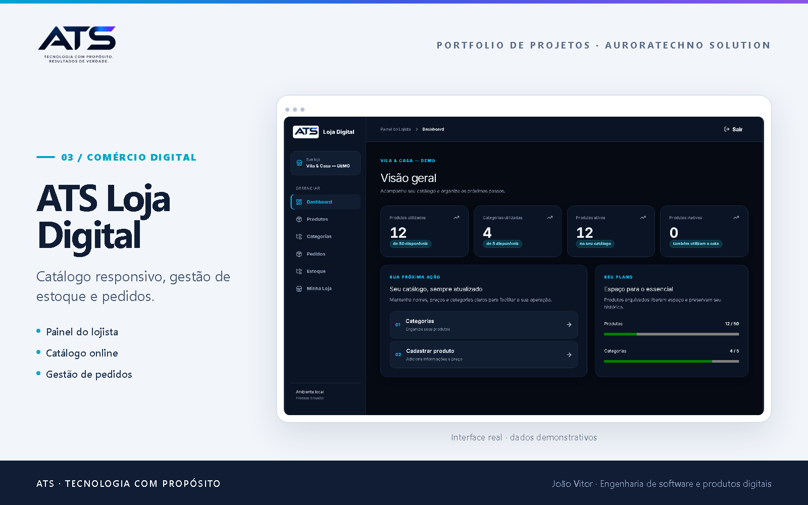
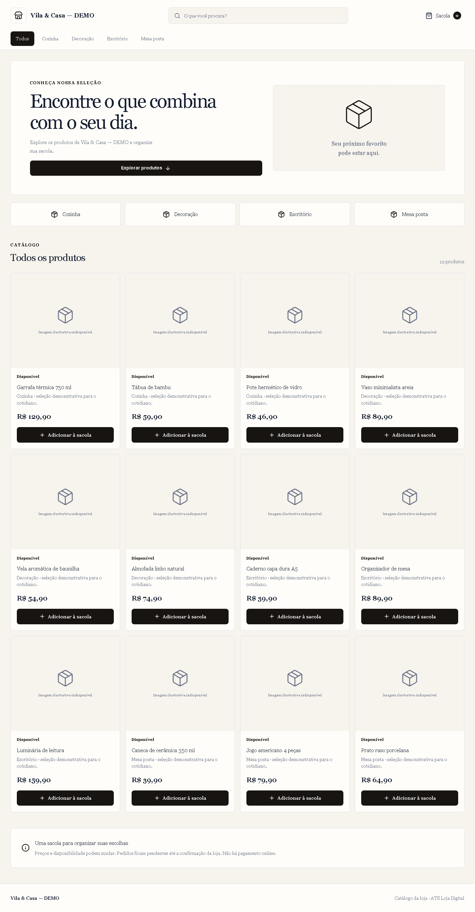
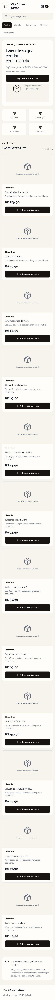
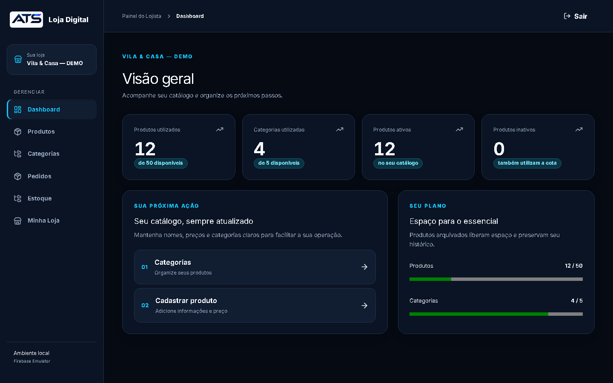
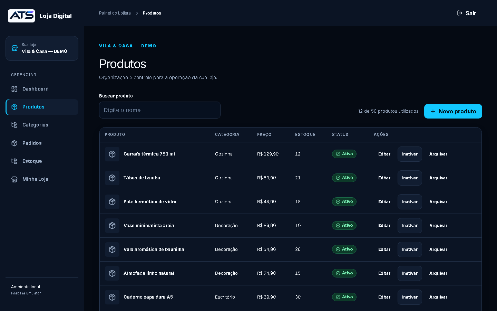
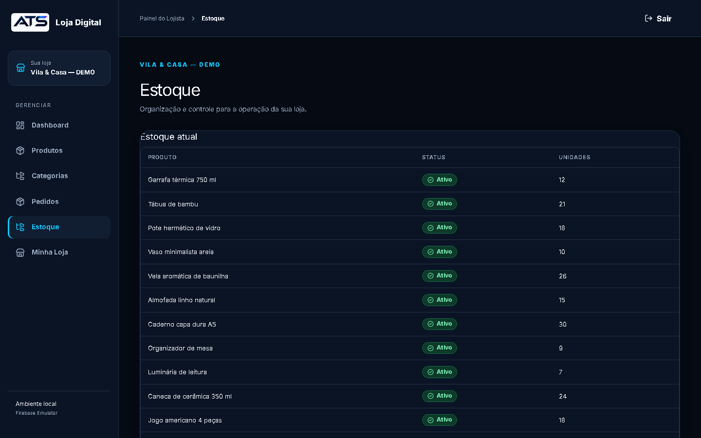
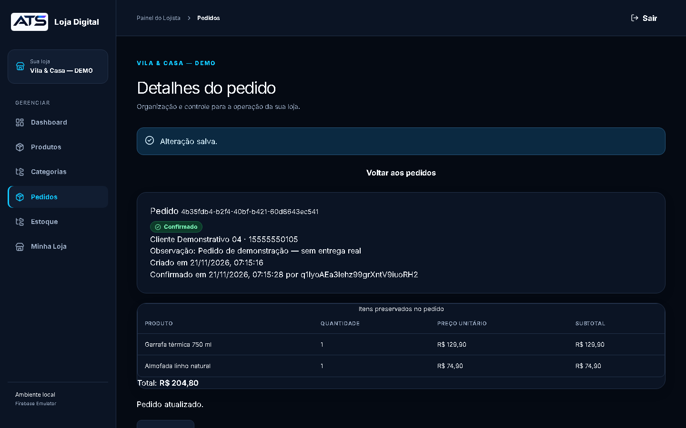

# ATS Loja Digital

**Catálogo digital responsivo, gestão de produtos, estoque e pedidos.**

[Português](#visão-geral) · [English summary](#english-summary)



## Visão geral

ATS Loja Digital é uma solução desenvolvida pela AuroraTechno Solution para pequenos comércios que precisam disponibilizar um catálogo digital e centralizar a rotina de gestão de seus produtos e pedidos.

Esta versão pública apresenta o núcleo demonstrativo da plataforma, com experiência para clientes e lojistas, sem depender de uma conta Firebase ou serviço pago.

## Funcionalidades

- Catálogo público responsivo, organizado por categorias e com pesquisa.
- Sacola, cálculo de valores e criação de pedidos sem cadastro do cliente.
- Painel lojista com gestão de produtos, categorias e estoque.
- Confirmação, cancelamento e estorno conforme as regras de negócio.
- Registro de movimentações de estoque e sincronização da disponibilidade pública.
- Checkout com tentativa idempotente e link opcional para WhatsApp, sem envio automático.
- Separação entre lojas, autenticação e regras de acesso.
- Design System ATS 2.0 com componentes e temas.

## Demonstração visual

Capturas reais desta versão em ambiente demonstrativo local, com lojas, produtos e pedidos fictícios.

### Catálogo desktop e mobile



### Painel e controle operacional





## Arquitetura

| Camada | Tecnologias |
| --- | --- |
| Interface | React, TypeScript, Vite |
| Design | Tailwind CSS, Radix UI, Motion e Lucide |
| Domínio | TypeScript, casos de uso e contratos |
| Autenticação e dados | Firebase Auth e Firestore (Emulators) |
| Comandos privilegiados | Firebase Functions local |
| Testes | Vitest, Rules Unit Testing, Playwright |

As projeções públicas são separadas dos registros privados. O checkout cria um pedido pendente; a confirmação baixa o estoque de forma transacional. O cancelamento pendente não movimenta o estoque, enquanto o estorno restitui os itens conforme as regras do domínio.

## Executar localmente

Requisitos: Node.js 24.15 a 24.x, npm e Java 21. A instalação inicial depende de internet para baixar as dependências e os Emulators.

Na raiz do repositório, em CMD:

```cmd
npm ci
npm ci --prefix functions --ignore-scripts
```

Terminal 1:

```cmd
npm run emulators
```

Terminal 2, após o ambiente local ficar pronto:

```cmd
npm run seed:public
npm run dev:local
```

Abra:

- Catálogo: http://127.0.0.1:4174/loja/store-a-demo
- Painel: http://127.0.0.1:4174/login

Credenciais exclusivamente fictícias de teste no Emulator: `merchant-a@ats-demo.test` / `AtsDemo2026!`. Não use em serviços externos.

**Atenção:** `seed:public` recria os dados das duas lojas DEMO. Use apenas em um ambiente local descartável, sem dados que deseje preservar. O Firebase Project ID utilizado é `demo-ats-loja-digital`, sem fallback para projeto remoto.

## Validação

```cmd
npm run typecheck
npm run lint
npm run test
npm run build:local
npm run build:functions
```

Os testes de integração usam seus próprios Emulators; encerre os manuais antes de executá-los.

Validação do snapshot: typecheck, lint e builds de frontend e Functions concluídos; 69 testes de interface, 141 de domínio, 40 de regras de acesso e 54 de Functions passaram. A validação de navegador local confirmou 12 produtos em quatro categorias, criação de quatro pedidos e confirmação de um pedido, sem erros de página registrados.

## Escopo público

Snapshot independente do marco funcional anterior ao painel de billing e à migração de infraestrutura Cloudflare. Não contém dados comerciais reais, arquivos de ambiente privados, histórico de trabalho, configuração de produção, cobrança automática ou implantação remota. O WhatsApp é um link explícito na interface, não uma automação de envio.

Este é um projeto de portfólio, não uma declaração de prontidão comercial ou homologação de produção.

## Créditos

Desenvolvimento: João Vitor Silva Carvalho Costa — AuroraTechno Solution.

Componentes adaptados de projetos abertos têm os avisos de terceiros preservados em [THIRD-PARTY-NOTICES.md](THIRD-PARTY-NOTICES.md). Nenhuma nova licença geral de código aberto é concedida ao código próprio da ATS neste snapshot.

## English summary

ATS Loja Digital is an AuroraTechno Solution portfolio project combining a mobile-friendly digital storefront with a merchant dashboard, product and inventory management, and order workflows. This public snapshot runs locally using Firebase Emulators, with synthetic data and no production credentials or paid service.
